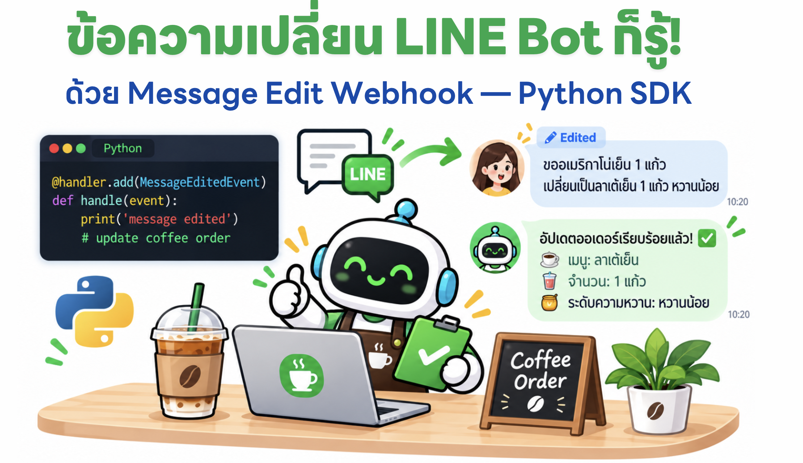
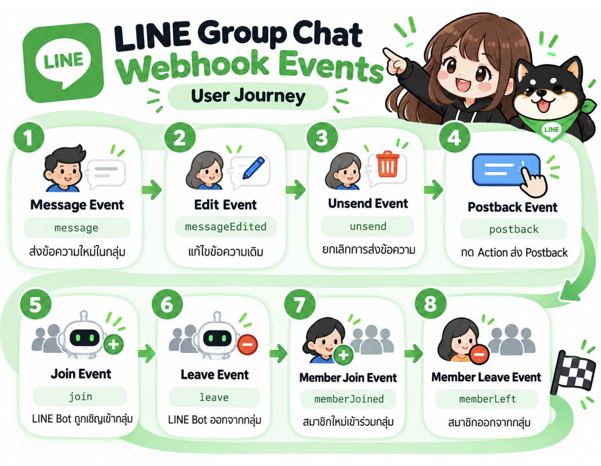
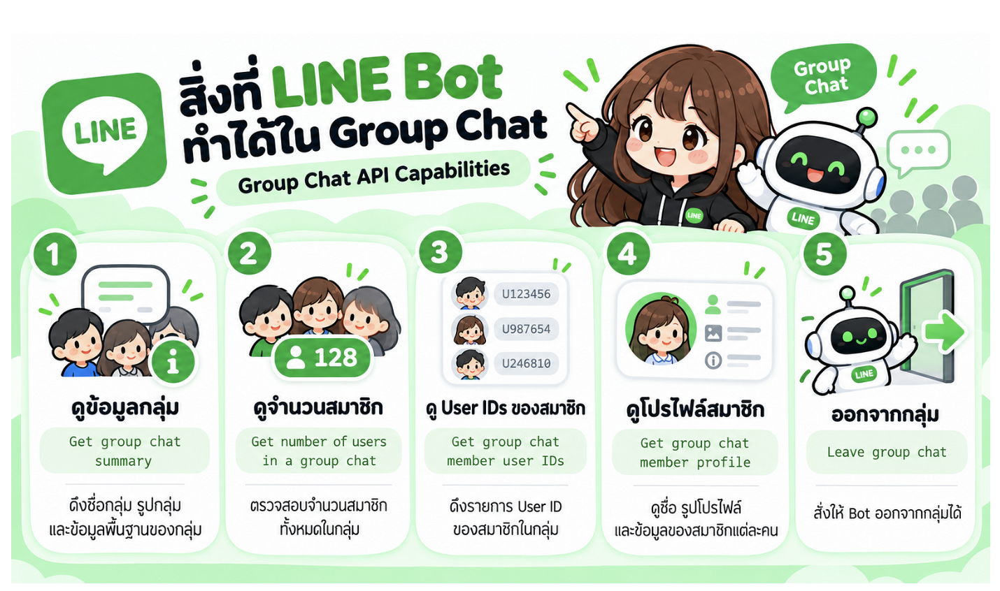

# LINE Group Chatbots


บอท LINE สำหรับแชทกลุ่ม เขียนด้วย Python แต่ละโฟลเดอร์เป็นบอทคนละตัว รับ webhook ผ่าน [Functions Framework](https://github.com/GoogleCloudPlatform/functions-framework-python) และตอบกลับด้วย [LINE Messaging API](https://developers.line.biz/en/docs/messaging-api/)

| โฟลเดอร์ | ทำอะไร |
| --- | --- |
| [`line-coffee-group`](line-coffee-group) | จดออเดอร์เครื่องดื่มในกลุ่ม แล้วส่งร้านเมื่อกดยืนยัน |
| [`line-groups-party-rsvp`](line-groups-party-rsvp) | รับ `+1` / `-1` ในกลุ่ม แล้วแสดงการ์ดผู้เข้าร่วม |
| [`line-group-features`](line-group-features) | ตัวอย่าง webhook ของกลุ่ม: ข้อความ, แก้ข้อความ, unsend, เข้า-ออกกลุ่ม, กดปุ่ม |

## ร้านกาแฟ

ลูกค้าพิมพ์สั่งเครื่องดื่ม บอทจดรายการไว้ก่อน แล้วส่งปุ่มให้กดยืนยัน ออเดอร์ถูกส่งร้านเมื่อกดปุ่มเท่านั้น ใช้ Gemini ช่วยอ่านข้อความสั่ง และเก็บรายการใน SQLite

```bash
cd line-coffee-group
cp .env.example .env
python -m venv .venv
source .venv/bin/activate
pip install -r requirements.txt
functions-framework --target=callback --port=8080
```

ตั้งค่าใน `.env`

- `LINE_CHANNEL_SECRET` และ `LINE_CHANNEL_ACCESS_TOKEN` จาก LINE Developers Console
- Gemini ผ่าน Vertex AI (`GOOGLE_GENAI_USE_VERTEXAI`, `GOOGLE_CLOUD_PROJECT`, `GOOGLE_CLOUD_LOCATION`) หรือ `GEMINI_API_KEY`

รายละเอียดอยู่ใน [line-coffee-group/README.md](line-coffee-group/README.md)

## ชวนปาร์ตี้

ในกลุ่ม พิมพ์ `+1` เมื่อไป และ `-1` เมื่อไม่ไป บอทส่งการ์ดผู้เข้าร่วมทุกครั้งที่รายชื่อเปลี่ยน ถ้าแก้ข้อความเดิมจาก `+1` เป็น `-1` บอทรับ `messageEdited` แล้วขึ้นว่าเปลี่ยนใจ

```bash
cd line-groups-party-rsvp
cp .env.example .env
uv sync
uv run functions-framework --target=callback --port=8080
```

ตั้ง `LINE_CHANNEL_SECRET` และ `LINE_CHANNEL_ACCESS_TOKEN` ใน `.env` รายละเอียดอยู่ใน [line-groups-party-rsvp/README.md](line-groups-party-rsvp/README.md)

## แก้ข้อความแล้วรายการตาม



LINE ส่งอีเวนต์คนละชนิดเมื่อสมาชิกพิมพ์ครั้งแรกกับเมื่อแก้ข้อความเดิม

1. พิมพ์ครั้งแรก เช่น `อเมริกาโน่ หวานน้อย` บอทได้ `message` แล้วจดออเดอร์ผูกกับ message id ของข้อความนั้น
2. กดแก้ไขข้อความเดิมเป็น `อเมริกาโน่ หวานปานกลาง` บอทได้ `messageEdited` ของ message id เดียวกัน จึงทับรายการเดิม ไม่สร้างแก้วใหม่
3. บอทตอบการ์ดสรุปออเดอร์ของรอบนั้น เช่น อเมริกาโน่ (หวานปานกลาง) และชาเขียว (หวานมาก) รวม 2 แก้ว

บอทปาร์ตี้ใช้เหตุการณ์เดียวกัน ถ้าแก้ `+1` เป็น `-1` รายชื่อผู้เข้าร่วมจะเปลี่ยนตามข้อความล่าสุด

## สิ่งที่บอททำได้ในกลุ่ม



เมื่อบอทอยู่ในกลุ่ม LINE มี API กลุ่มให้เรียกได้ 5 อย่าง

| API | ใช้เมื่อ |
| --- | --- |
| Get group chat summary | ดึงชื่อกลุ่ม รูปกลุ่ม และข้อมูลพื้นฐานของกลุ่ม |
| Get number of users in a group chat | นับจำนวนสมาชิกทั้งหมดในกลุ่ม |
| Get group chat member user IDs | ดึงรายการ User ID ของสมาชิกในกลุ่ม |
| Get group chat member profile | ดูชื่อที่แสดงและรูปโปรไฟล์ของสมาชิกคนหนึ่ง |
| Leave group chat | สั่งให้บอทออกจากกลุ่ม |

บอทร้านกาแฟและบอทปาร์ตี้เรียก **Get group chat member profile** ตอนมีข้อความเข้ามา เพื่อเอาชื่อและรูปไปใส่ในการ์ดออเดอร์หรือการ์ดผู้เข้าร่วม

ตัวอย่างการรับอีเวนต์กลุ่มอยู่ใน [`line-group-features/main.py`](line-group-features/main.py) ครอบคลุม `message`, `messageEdited`, `unsend`, `join`, `leave`, `memberJoined`, `memberLeft` และ `postback`

```bash
cd line-group-features
cp .env.example .env
python -m venv .venv
source .venv/bin/activate
pip install -r requirements.txt
functions-framework --target=callback --port=8080
```

## Webhook

ใน LINE Developers Console เปิด Use webhook แล้วใส่ URL ของเซิร์ฟเวอร์ที่รันฟังก์ชัน `callback` เช่น `https://<host>/` ต้องใช้ HTTPS ที่ LINE เข้าถึงได้

อย่า commit ไฟล์ `.env` ค่าลับอยู่ใน `.env.example` เป็นตัวอย่างเท่านั้น
