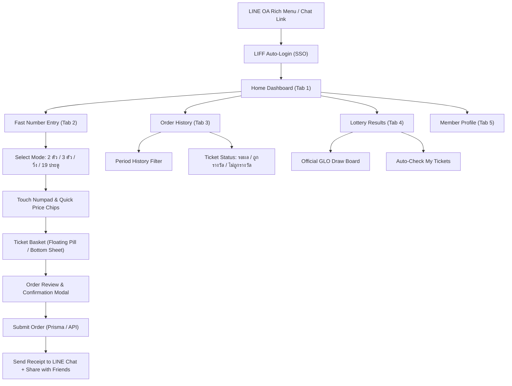

# LINE MINI App / LIFF Design Specification & Roadmap
**Project:** Longdu Lotto (`longdu-lotto`)  
**Target User Role:** Role 4 (Member / Buyer)  
**Platform:** LINE Front-end Framework (LIFF SDK v2.31+) / Mobile Webview  
**Design Intelligence:** UI/UX Pro Max + Modern Web Guidance  
**Status:** All 5 Phases Fully Implemented & Verified ✅

---

## 1. Executive Summary & Design Vision

The **Longdu Lotto LINE MINI App** is a mobile-first web application running directly within the LINE messenger app. It empowers members (buyers) to browse lottery periods, build and submit tickets with instant discount calculation, track order history, and verify winning numbers with official GLO results.

### Core Design Principles
1. **Frictionless Mobile Ergonomics (`ui-ux-pro-max`)**:
   - Touch targets strictly meet or exceed **44×44px** on iOS and **48×48px** on Android.
   - Minimum **8px spacing** between clickable buttons.
   - Navigation restricted to a **5-tab bottom navigation bar** with safe-area padding.
   - Native-feeling touch responsiveness without accidental zoom or scroll chaining.
2. **Fintech Trust Meets Lottery Excitement**:
   - **Primary Palette**: Emerald & Deep Teal (`#059669` / `#065F46`) signifying growth and security, aligned with LINE's brand aesthetic.
   - **Accent/Jackpot**: Warm Amber/Gold (`#D97706` / `#F59E0B`) for wins, multipliers, and CTAs.
   - **Surface & Cards**: High contrast cards with clean borders (`border-slate-200 / border-slate-800`), supporting both Light and Dark mode.
3. **Modern Web Standards (`modern-web-guidance`)**:
   - Native `<dialog>` and Bottom Sheets utilizing pure CSS `overscroll-behavior: contain` on both dialog and `::backdrop` to prevent background scroll leaks.
   - Form field validation utilizing `:user-invalid` and `:user-valid` so users never see intrusive premature errors while typing numbers.
   - Accessible color contrast exceeding WCAG AA (4.5:1 ratio) and full `prefers-reduced-motion` compliance.

---

## 2. Information Architecture & Screen Flow



---

## 3. Screen Specifications

### Screen 1: Home Dashboard (`/`)
* **Header**: User LINE avatar, display name, and active wallet/credit balance with refresh button.
* **Period Hero Banner**: 
  - Current Lottery Period (`งวดประจำวันที่ 1 พฤศจิกายน 2569`)
  - Status Badge: `OPEN` (เปิดรับแทง) / `CLOSING SOON` / `CLOSED`
  - Real-time countdown timer to cutoff (`ปิดรับแทงในอีก 02:45:12`)
* **Quick Action Cards**:
  - "แทงหวยด่วน" (Instant Bet)
  - "ตรวจผลรางวัลล่าสุด" (Check Results)
  - "โพยล่าสุดของฉัน" (Recent Order Quick Status)
* **Announcement Carousel**: Rules, payout rates (อัตราจ่าย: 3 ตัวบาทละ 900, 2 ตัวบาทละ 95), and notification banners.

### Screen 2: Fast Ticket Entry (`/bet` or Tab 2)
* **Mode Switcher (Segmented Control)**:
  - 2 ตัว (บน / ล่าง / กลับ)
  - 3 ตัว (บน / โต๊ด / ล่าง / หน้า / 6 กลับ)
  - วิ่ง (บน / ล่าง)
  - รูด 19 ประตู (รูดหน้า / รูดหลัง)
* **Number Display & Touch Keypad**:
  - Clean digit display with tabular font (`font-mono`) to prevent layout shifts.
  - Quick Price Presets: `+10`, `+20`, `+50`, `+100`, `+500` THB chips.
  - Permutation Switcher (`กลับเลขอัตโนมัติ`) reflecting business logic from legacy suite.
* **Live Calculation Bar**:
  - Number of generated tickets (e.g. `123 กลับ 6 ประตู = 6 รายการ`)
  - Subtotal, Discount (`หักส่วนลด 10%`), and Net Total.
  - "เพิ่มลงโพย" (Add to Basket) CTA button with tactile feedback.

### Screen 3: Order Review Bottom Sheet & Submission
* **Native Bottom Sheet**:
  - Implements `overscroll-behavior: contain` to isolate scroll gestures.
  - List of items with swipe-to-delete or remove button.
  - Financial breakdown:
    $$\text{ยอดแทงรวม} - \text{ส่วนลดสมาชิก} = \text{ยอดชำระสุทธิ}$$
* **Submission Action**:
  - Calls Next.js Server Action / API with idempotency key.
  - Option to send digital receipt directly to LINE chat (`liff.sendMessage`).
  - Option to invite friends (`liff.shareTargetPicker`).

### Screen 4: Order History (`/history` or Tab 3)
* **Period Dropdown**: Filter orders by past periods.
* **Order Card**:
  - Order Code (`#ORD-9021`), Date/Time, Total Tickets.
  - Status Tag:
    - 🟡 `รอออกรางวัล` (Pending draw)
    - 🟢 `ถูกรางวัล ฿1,800` (Win highlight with confetti animation)
    - ⚪ `ไม่ถูกรางวัล` (Settled without prize)
* **Expandable Ticket Breakdown**: Inspect individual numbers, payout multipliers, and draw comparisons.

### Screen 5: Live Lottery Results (`/results` or Tab 4)
* **Official Draw Grid**:
  - รางวัลที่ 1 (6 หลัก)
  - เลขหน้า 3 ตัว (2 รางวัล)
  - เลขท้าย 3 ตัว (2 รางวัล)
  - เลขท้าย 2 ตัว (1 รางวัล)
* **Auto-Check Feature**: One-tap button that queries user's active tickets and calculates total winnings automatically.

---

## 4. UI/UX Tokens & CSS Setup

### Color System (`oklch` & CSS Custom Properties)
```css
:root {
  /* Brand & Status */
  --color-primary: #059669;        /* Emerald 600 - Action & Primary */
  --color-primary-hover: #047857;  /* Emerald 700 */
  --color-secondary: #0F172A;      /* Slate 900 - High contrast text/headers */
  --color-accent: #D97706;         /* Amber 600 - Win & Multipliers */
  --color-accent-light: #FEF3C7;   /* Amber 100 - Win backgrounds */
  
  /* Surfaces */
  --color-bg-mobile: #F8FAFC;      /* Slate 50 */
  --color-card-mobile: #FFFFFF;
  --color-border-subtle: #E2E8F0;  /* Slate 200 */
  
  /* Safe Areas for LINE In-App Webview */
  --safe-area-top: env(safe-area-inset-top, 0px);
  --safe-area-bottom: env(safe-area-inset-bottom, 16px);
}
```

### Bottom Navigation Specs (5 Tabs)
1. **Home (`/`)**: `<Home className="w-5 h-5" />` - ภาพรวมและงวด
2. **Bet (`/bet`)**: `<Ticket className="w-6 h-6" />` - ซื้อหวย (Prominent center button)
3. **History (`/history`)**: `<History className="w-5 h-5" />` - โพยของฉัน
4. **Results (`/results`)**: `<Award className="w-5 h-5" />` - ผลสลาก
5. **Profile (`/profile`)**: `<User className="w-5 h-5" />` - บัญชีผู้ใช้

---

## 5. Five-Phase Implementation Roadmap

| Phase | Scope | Focus Area | Status |
| :--- | :--- | :--- | :--- |
| **Phase 1** | **Architecture, Design System & IA** | Design tokens, master spec, IA flow, `ui-ux-pro-max` & `modern-web-guidance` integration | ✅ **Completed** |
| **Phase 2** | **Navigation Shell & Mobile Layout** | Mobile container, 5-tab Bottom Nav with safe areas, Header with Period countdown | ✅ **Completed** |
| **Phase 3** | **Fast Number Entry & Ticket Basket** | Mode tabs (2ตัว/3ตัว/วิ่ง/19ประตู), Touch Numpad, Price chips, Basket state | ✅ **Completed** |
| **Phase 4** | **Order Confirmation & LIFF Chat** | Review Bottom Sheet, pure CSS scroll containment, Send to LINE chat & Share | ✅ **Completed** |
| **Phase 5** | **Order History, GLO Draw & Polish** | History cards, Live result checker, auto-match prizes, WCAG 4.5:1 audit | ✅ **Completed** |

---
*Created per Matt Pocock skill conventions in `docs/specs/line-mini-app-design.md`.*
